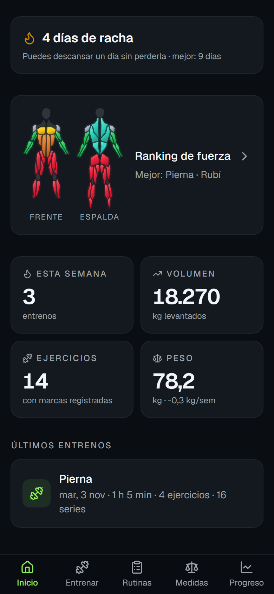
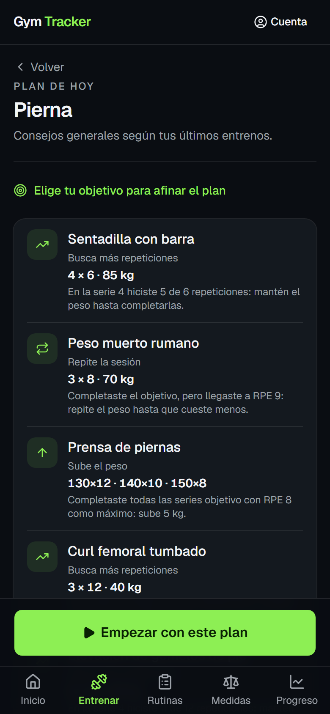
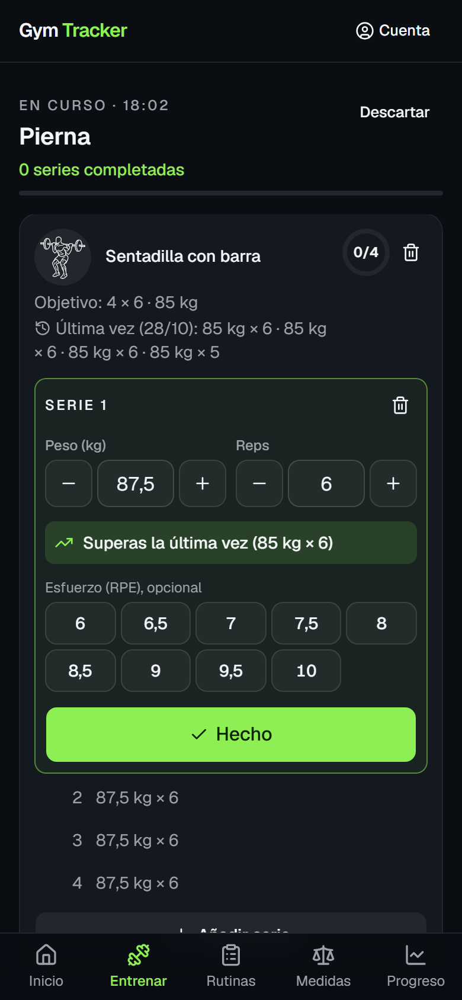
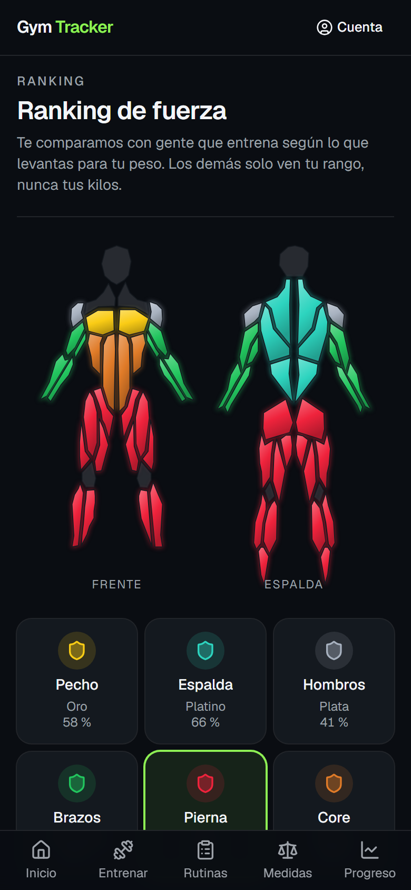
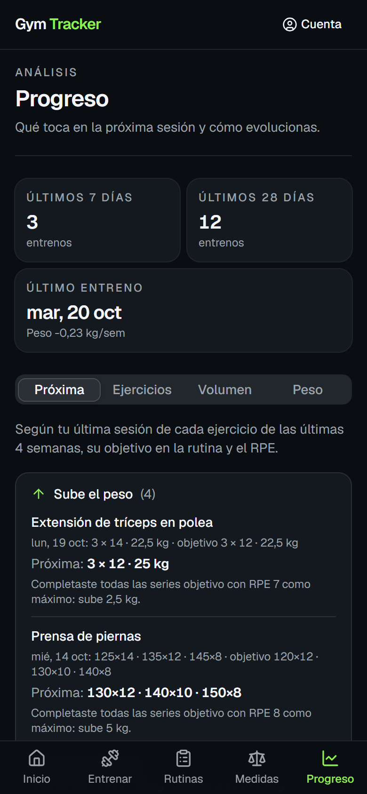
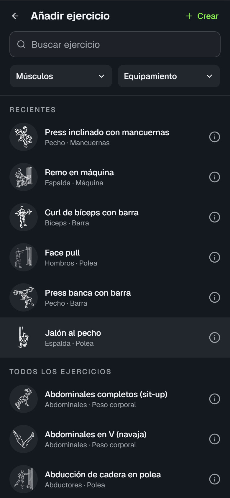
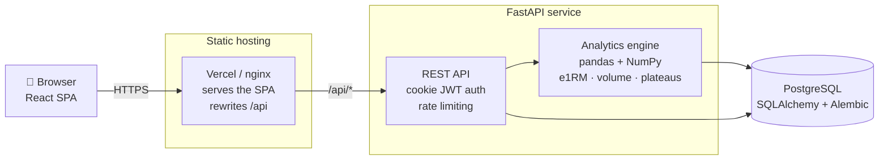

# Gym Tracker

[](https://github.com/danialco9/gym-tracker/actions/workflows/backend-ci.yml)
[](https://github.com/danialco9/gym-tracker/actions/workflows/frontend-ci.yml)

Web app to log gym workouts, track body measurements and use data analysis to decide when to
change routines, exercises or intensity.

**[Live demo](https://gym-tracker-two-beta.vercel.app)** — press *Probar la demo* to sign in to an
account with 12 weeks of simulated training. No sign-up needed.

<p align="center">
  
  
  
</p>
<p align="center">
  
  
  
</p>

> Personal project and portfolio piece. The interface is in Spanish; the code, commits and docs are
> in English. Open to anyone: each account sees only its own data, and the ranking shows a
> nickname and a tier, never weights.

## Install it on your phone

It is a web app (PWA): there is nothing to download from a store. Once added to the home screen it
opens full screen with its own icon, like any other app, and works without coverage.

**iPhone (Safari)**

1. Open https://gym-tracker-two-beta.vercel.app in **Safari**. On iOS, only an app added from
   Safari gets notifications.
2. Tap the **Share** button (*Compartir*, the square with an arrow). On iOS 26 it is behind the
   **•••** button next to the address bar.
3. Scroll down and tap **Add to Home Screen** (*Añadir a pantalla de inicio*). If *Open as Web App*
   (*Abrir como app web*) shows, leave it on.
4. Tap **Add** (*Añadir*), then open **Gym Tracker** from the home screen and sign in.
5. To be told when a rest ends with the phone locked, tap **Avisarme** on the rest bar during a
   workout and allow notifications. It needs iOS 16.4 or later and the app opened from the home
   screen, not from Safari.

**Android (Chrome)**

1. Open https://gym-tracker-two-beta.vercel.app in **Chrome**.
2. Tap **Install** (*Instalar*) if Chrome offers it below the address bar, or open the **⋮** menu
   and choose **Install app** (*Instalar aplicación*). On some phones it reads **Add to Home
   screen** (*Añadir a pantalla de inicio*).
3. Confirm, then open **Gym Tracker** from the home screen or the app drawer and sign in.
4. For the end-of-rest notice, tap **Avisarme** on the rest bar and allow notifications.

**Updates** install themselves: the app checks for a new version each time it opens. To uninstall,
remove it like any other app (long press on the icon).

## What it does

- **Live workout logging.** Mobile-first screen built for the gym floor: one exercise per card,
  swiped sideways (CSS scroll snap) and moving on by itself when its sets are done, big
  `±2.5 kg` / `±1 rep` buttons, a ring with the sets done, the previous performance of each
  exercise in view, and a hint when a set would beat your record. Each set is compared with the
  same set last time ("Superas la última vez"), with a one-tap target to beat it, and *Completar
  todas* ticks the rest of an exercise at once, with an undo. A rest bar above the bottom
  navigation follows each set, as long as your goal asks for, leaving the workout usable while it
  counts down, and it announces the next set of the exercise in hand. The draft is kept in
  `localStorage`, so a lost connection or a locked phone never loses a set.
- **Visual exercise picker.** A catalog of 209 exercises with line drawings, search, muscle and
  equipment filters and your recent exercises first; an info sheet animates the movement, and
  anything missing can be added as your own exercise. When a machine is taken mid-workout,
  *Cambiar* offers the closest exercises for the same muscle and swaps it in place, with the weight
  you lifted on it last time; sets already done stay with the original.
- **Training goal and today's plan.** Pick lose fat, build muscle, build strength or recomposition, and the app
  sets the rep ranges, effort (RIR, reps in reserve), rest and weekly volume to aim for. Opening a
  routine shows today's plan first: what to do with each exercise and why, and how the week's volume of its
  muscles compares with the goal. One tap starts the workout with the suggested weights.
- **Training streak.** Days in a row with workouts, where one rest day does not break it.
- **Weekly overload summary.** The home screen says how many exercises trained this week beat the
  session before ("4 de 6 ejercicios superan la última vez"), judged set by set as during the
  workout, and lists which ones beat it, matched it or need a push.
- **Strength ranking.** For every exercise, the share of people you out-lift ("stronger than
  64 %"), from your best estimated 1RM divided by your body weight, so light and heavy lifters
  compete on equal terms. The percentile gives a tier from Bronze to Master, per exercise and per
  body zone (chest, back, shoulders, arms, legs, core), painted on a body figure in the tier's
  colour. Each tier has a medal of its own, told apart by shape as well as colour: round, starred,
  scalloped and seal medals, then gem cuts and a crown for Máster. The list shows only a nickname and a tier, and anyone can leave it from the account
  screen.
- **Routines with per-set targets.** Each exercise carries ordered set rows (reps, weight, optional
  RIR), so pyramids and ramps are described exactly and prefill the next workout. Drag to reorder,
  with keyboard support.
- **Logging a workout in plain language.** Type (or dictate with the phone keyboard) `prensa 4x10
  120, press banca 12,10,8 a 60 rir 2` and the server reads it into sets, matched against your
  exercise catalog. It never saves on its own: the reading prefills the workout screen for you to
  review. Where the text genuinely fits more than one exercise - `press banca` is both the barbell
  and the dumbbell entry - it offers the candidates instead of guessing, since the wrong one
  quietly spoils the history.
- **Installable on the phone.** A PWA: added to the home screen it opens standalone, and the app
  shell is precached by a service worker, so it starts with no connection at all. Once you have
  signed in on that device it opens straight into the app offline, on the last session the server
  confirmed, instead of a login page it cannot submit. The API itself is never cached — a stale
  workout is worse than an honest error — so the screens say when they are offline. A workout
  finished with no coverage waits in a queue on the phone and is sent on its own when the
  connection returns; it carries a client id, so a retry after a lost answer is never saved twice.
  A locked phone freezes the page, so the end of a rest can also arrive as a Web Push sent by the
  API ("Avisarme" on the rest bar).
- **Body measurements.** Quick weight entry plus an optional full set of measurements, with history
  and a weight trend chart.
- **Progress dashboard.** Estimated 1RM per exercise, weekly hard sets by muscle group, personal
  records and body weight trend. The volume tab opens on a body figure that fills each muscle as
  the week's hard sets reach the goal's range: grey below, green inside, orange above.
- **Training recommendations.** The analytics engine compares the sets you actually did against the
  ones the routine planned: everything hit with 2 or more reps in reserve adds load to every
  planned set (keeping the pyramid shape), missed reps suggest holding, and a detected plateau suggests a deload. The load
  step depends on the equipment (2 kg dumbbells, 2.5 kg barbell, doubled for heavy leg lifts), and
  when it would be more than 10% of the weight, reps go up first. With a training goal
  picked, the reps move too (double progression): one more rep per set until every set reaches
  the top of the goal's range, then a heavier weight worked out from the estimated max that
  brings the reps back to its bottom (3 × 12 with 60 kg becomes 3 × 8 with 65 kg, or 3 × 6 with
  70 kg for strength). Multi-joint and single-joint lifts each use their own range. Every suggestion says why, and
  only exercises trained in the last four weeks get one. It also flags main muscles trained below
  10 or above 20 hard sets a week, counting a set as half for its secondary muscles.
- **Training blocks.** Optionally, train in 4–6 week blocks whose last week is a deload: the home
  screen shows the week of the block, and in the deload week today's plan halves the sets at the
  same weights with 3–4 reps in reserve, without touching the routine. Deload sessions are left
  out of the next recommendations, so a light week never reads as missed reps or a plateau. A new
  block starts on its own after the deload.

## Architecture



The SPA and the API are served from the same origin on purpose: the session JWT travels in an
`HttpOnly`, `Secure`, `SameSite=Lax` cookie, which a cross-site frontend could not send. In
production the web project on Vercel rewrites `/api` to a second Vercel project that runs the
FastAPI app as a function (no cold start of a sleeping container); in Docker Compose nginx does the
same.

## Stack

| Area | Technology |
| --- | --- |
| Frontend | React 19, TypeScript, Vite, Tailwind CSS, shadcn/ui, TanStack Query, React Router, Recharts, vite-plugin-pwa |
| Backend | Python 3.12, FastAPI, SQLAlchemy 2.0 (typed), Alembic, Pydantic |
| Data analysis | pandas, NumPy (scikit-learn planned) |
| Database | PostgreSQL 18 |
| Tooling | uv, Ruff, mypy, pytest · pnpm, oxlint, Prettier, Vitest |
| CI/CD | GitHub Actions (tests, end-to-end, production migrations, nightly demo reset) · Vercel (web and API) · Neon (database) |

## Repository layout

```
backend/    FastAPI service, analytics engine and production Dockerfile
frontend/   React single-page app, nginx image and Vercel config
e2e/        Playwright flows against the full stack
data/       Interim CSV training log
docs/       Deployment guide, image credits and README screenshots
docker-compose.yml   Full local stack (PostgreSQL, API, web)
render.yaml          Former Render Blueprint for the API (now on Vercel, see the deployment guide)
```

## Getting started

### Run everything with Docker

Requirements: [Docker](https://docs.docker.com/get-docker/) with Compose.

```bash
docker compose up --build
```

Open http://localhost:8080 and press **Probar la demo**: the demo account comes with 12 weeks of
simulated training. The API docs are at http://localhost:8000/docs.

Compose starts PostgreSQL, the API (it applies the migrations and seeds the exercise catalog and the
demo account on start) and nginx serving the web app and proxying `/api`. It works without a `.env`
file; the defaults are for local use only (see `.env.example` to change passwords or ports).

### Develop with hot reload

Requirements: Docker, [uv](https://docs.astral.sh/uv/), Node.js 24 and pnpm.

```bash
cp .env.example .env          # then set POSTGRES_PASSWORD, GYM_DATABASE_URL and GYM_JWT_SECRET
docker compose up -d --wait db   # start only PostgreSQL

cd backend
uv sync
uv run alembic upgrade head   # create the database schema
uv run gym-admin create-user --email you@example.com
uv run uvicorn gym_tracker.main:create_app --factory --reload   # http://localhost:8000/docs
uv run gym-report             # training report from data/

cd ../frontend
pnpm install
pnpm dev                      # http://localhost:5173
```

### Checks

```bash
cd backend  && uv run ruff check . && uv run mypy . && uv run pytest
cd frontend && pnpm lint && pnpm test && pnpm build
```

Backend tests run against a real PostgreSQL started with testcontainers, so migrations and queries
are exercised the same way they run in production.

The end-to-end flows need the stack running, and drive a phone-sized browser through nginx, the API
and PostgreSQL with nothing mocked ([how a run is set up](e2e/README.md)):

```bash
GYM_RATE_LIMIT_ENABLED=false docker compose up -d --wait --build
cd e2e && pnpm install && pnpm exec playwright install chromium && pnpm test
```

## Engineering notes

A few decisions worth calling out:

- **Auth.** Passwords hashed with Argon2; the session JWT is stored in an `HttpOnly` cookie instead
  of `localStorage`, so a XSS bug cannot read it. Login and registration are rate limited
  (moving window, `429` with `Retry-After`). "Mantener la sesión iniciada" gives a week-long
  cookie that is reissued once a day while in use, so it only ends after a week of inactivity;
  without it the cookie is session-only and the token lasts 12 hours at most.
- **Schema migrations.** Alembic runs on container start, so a fresh database and a deployed one
  follow exactly the same path.
- **Analytics.** Estimated 1RM (Epley), weekly hard sets per muscle group and plateau detection live
  in a pure module fed either from the CSV log or from PostgreSQL, which keeps it testable without a
  web request.
- **Derived, never stored.** The streak and the ranking are recomputed from the workout history
  on every request, so editing or deleting a workout can never leave them out of step with the log.
- **Fair strength percentiles.** Once 30 other users (of the same sex, if given) have done an
  exercise, a lift is ranked against them; until then, against an estimate of gym-goers: a
  log-normal spread per exercise around its own scale, because 1.5× body weight is little on a leg
  press but out of reach on a curl, with lower medians for women, closer on the legs. Main lifts
  are scaled by hand and the rest from muscle group and equipment. A zone's tier is the mean
  percentile of its exercises. Sets above 12 reps count as 12, since Epley overrates long sets.
  Weights, body weight and sex never leave the server; the demo account is never listed.
- **Typing and linting everywhere.** `mypy` on the backend and TypeScript `strict` on the frontend,
  both enforced in CI alongside the tests.

## Roadmap

- [x] Interim CSV training log and analytics engine (e1RM, PRs, weekly volume, weight trend, plateaus, progression)
- [x] App foundation: frontend shell, PostgreSQL in Docker, CI
- [x] Backend API foundation: models, migrations, cookie-based JWT auth, health check
- [x] Backend API: CRUD for exercises, routines, workouts and measurements; exercise catalog seed
- [x] Frontend: login and live workout logging (mobile first, last performance, rest timer, offline draft)
- [x] Account registration
- [x] Frontend: routines screen (create, edit, drag to reorder, per-set targets for pyramids and ramps)
- [x] Frontend: body measurements screen (quick weight entry, weight chart, history)
- [x] Progress analytics API (overview and per-exercise history) and demo account
- [x] Frontend: progress dashboard (recommendations, per-exercise charts, weekly volume, body weight)
- [x] Rate limiting on login and registration
- [x] Deployment setup: Vercel + Neon, public demo with nightly reset ([guide](docs/deployment.md)); the API moved from Render to Vercel to drop the cold start
- [x] One-command local stack with Docker Compose
- [x] End-to-end tests (Playwright) on the full stack, in CI
- [x] Screenshots in this README
- [x] Workout logging in plain language (rule-based reader, with the seam a language model plugs into)
- [ ] Language-model reading for the sentences the rules cannot reach
- [x] Installable PWA: standalone on the home screen, app shell precached, opens offline on the remembered session
- [x] Offline workout saving: a queue on the phone that syncs when the connection returns, deduplicated by a client id
- [x] Smarter recommendations: per-equipment load steps, reasons, weekly volume advice
- [x] Visual exercise picker: 209 exercises with drawings, filters, info sheet and custom exercises
- [x] "Remember me" session that ends after a week of inactivity
- [x] Training goal (lose fat, build muscle, build strength, recomposition) and today's plan per routine
- [x] Focus mode and swipeable exercise cards for the live workout
- [x] Daily training streak
- [x] Strength ranking by percentile, per exercise and per body zone, with nicknames and an opt-out
- [x] API moved to Vercel: no more minute-long wake-up, migrations run from GitHub Actions
- [x] Animated exercise drawings in the live workout, and set and record animations
- [x] Rest bar that leaves the workout usable, and an end-of-rest Web Push for a locked phone
- [x] Ranking painted on a body figure, one colour per tier
- [x] Progressive overload in the workout: each set against the same set last time
- [x] Weekly volume on the body: each muscle fills up towards the goal's range of hard sets
- [x] *Completar todas*: tick the rest of an exercise at once, with an undo
- [x] Weekly overload summary on the home screen: how many exercises beat last time, and which
- [x] Effort as reps in reserve (RIR) instead of RPE, while logging, in goals, routines, recommendations and dictation
- [x] Training blocks (mesocycles) of 4–6 weeks that end in a deload week with half the sets
- [x] Swap an exercise when the machine is taken, for the closest ones of the same muscle
- [x] Double progression in the rep range of the goal: more weight and fewer reps at the top of the range

## Ideas for the future

Not promised, roughly in order of value for the effort.

**Hypertrophy and progressive overload**

- [ ] Ramp the volume across a training block: a set more each week up to the deload.
- [ ] Warm-up sets worked out from the first working set (for example 40 %, 60 % and 80 %).
- [ ] Plate calculator: which plates to load on each side of the bar for the weight on screen.

**In the gym**

- [ ] Supersets and circuits: two exercises that alternate, with the rest only after the pair.
- [ ] Install guide inside the app: on an iPhone in Safari, explain how to add it to the home
  screen, which is also what unlocks the end-of-rest notification.

**History and data**

- [ ] Calendar of workouts with a heat map, and editing a saved workout from it.
- [ ] Export all your data to CSV (workouts, measurements), and import a CSV from another app.
- [ ] Progress photos next to the body weight chart.
- [ ] Forecasts with scikit-learn: when a lift is likely to stall, and the expected 1RM in a month.

**Engineering**

- [ ] Split the JavaScript bundle by route: the build warns that one chunk is over 500 kB, which
  slows the first open on mobile data.
- [ ] Language-model reading for the dictated sentences the rules cannot reach (listed above).
